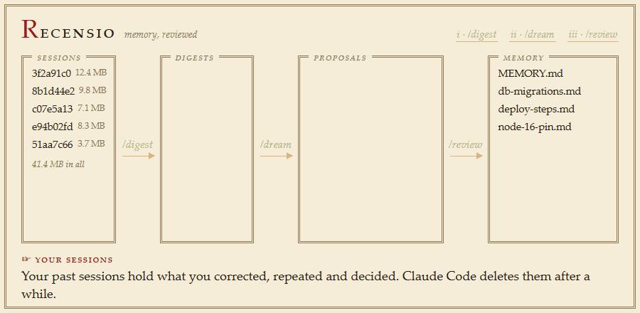
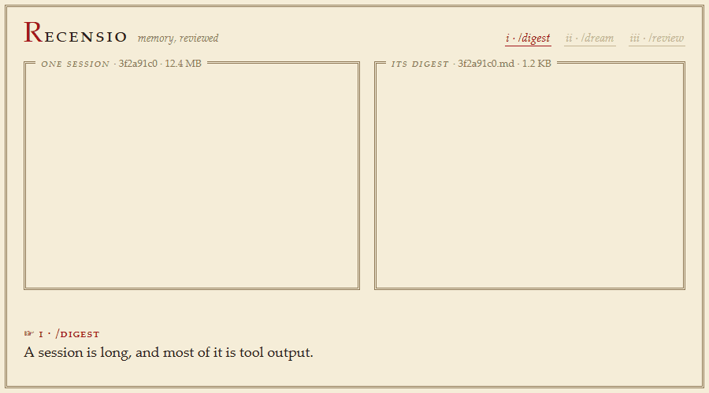
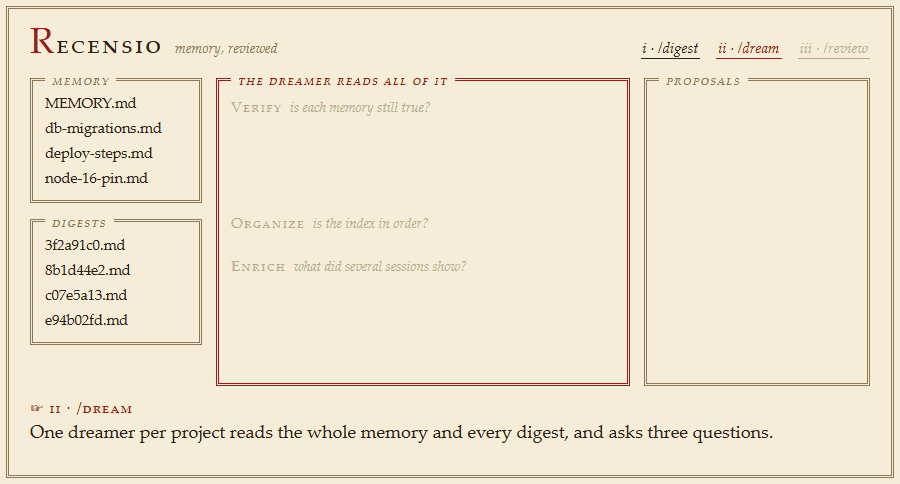
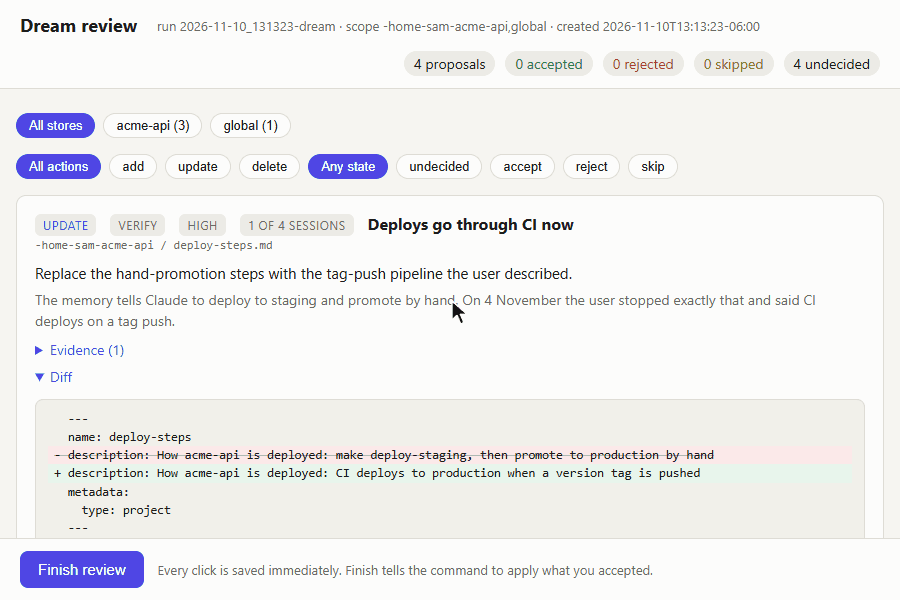
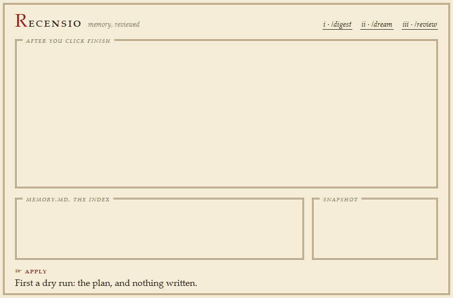

# recensio

**Claude Code remembers things between sessions. recensio checks that what it remembers is
still true, and teaches it what you keep having to repeat.**

<p align="center">
  
</p>

*Recensio* is Latin for "a reviewing". In textual scholarship a recension is a critical
revision of a text, made by going back to its sources. This tool does that for Claude
Code's memory: the sources are your own past sessions, and you approve every change.

## The problem it solves

Claude Code keeps notes about your projects in memory files, and reads them at the start
of each session. It writes those notes while it is busy doing something else, one session
at a time. Three things go wrong over the months:

- **Notes go stale.** A memory says "deploy by hand" long after you moved to CI, and
  Claude follows it.
- **Patterns go unnoticed.** You tell Claude "run the tests before you commit" in three
  different sessions. Each session forgets, because no single session saw the pattern.
- **The index drifts.** Files pile up, some are listed twice, some not at all.

recensio is a separate pass that fixes this. It runs when you ask it to, reads your past
sessions, and comes back with a list of proposed changes and the evidence for each. You
accept or reject them one by one. Nothing is written to your memory until you say so.

The idea comes from what Anthropic's applied AI team calls *dreaming*: going over the
day's experience offline, the way sleep consolidates memory.

## How it works

There are three commands. You type them inside a Claude Code session started in this
folder.

### 1. `/digest` turns each session into a short digest

<p align="center">
  
</p>

A session transcript is long, and most of it is tool output. A worker reads each one for
*your* words: what you corrected, what you repeated, what you decided, and which tools
kept failing. It writes that down as a digest of a few kilobytes.

Digests are cheap to make and they last. Claude Code deletes transcripts after a while
(30 days unless you change `cleanupPeriodDays`); a digest is kept here for as long as you
like. Run `/digest` as often as you want: only new sessions are read.

### 2. `/dream` proposes changes

<p align="center">
  
</p>

For each project, a "dreamer" reads the whole memory store and every digest, and asks
three questions:

- **Verify.** Is each memory still true? It checks against what you said in later
  sessions, and against the project's `git log`.
- **Organize.** Is the index in order? Duplicates get merged and broken entries fixed.
- **Enrich.** What did several sessions show that no memory holds yet?

Every proposal names the sessions it came from and quotes you. An optional last pass looks
for rules that hold in *every* project ("ask before deleting anything") and proposes those
as global memories.

A dream only proposes. When it ends, your memory files are exactly as they were.

### 3. `/review` puts you in charge

<p align="center">
  
</p>

`/review` opens a page in your browser with one card per proposal: what would change, why,
the evidence, and a diff. Accept it, reject it, or edit the text and then accept. Every
click is saved, so you can close the tab and come back later.

### Then the accepted changes are applied

<p align="center">
  
</p>

When you click Finish, the tool takes a snapshot of every memory store it is about to
touch, then writes only what you accepted. The index is updated to match. Whatever you
rejected is left exactly as it was. To undo everything, copy the snapshot back.

> The clips use a made-up project. The review clip is a recording of the real page. The
> other four are drawings, filled with the numbers and messages the tool really produced
> for that project. See [About the clips](#about-the-clips).

## Try it

You need Claude Code with some session history, and Python 3.9 or newer. There is nothing
to install.

```
git clone https://github.com/jfranecki/recensio.git
cd recensio
python tools/selftest.py           # optional: runs the whole pipeline on fake data
python tools/dreamctl.py projects  # lists the memory stores and sessions it can see
claude                             # start Claude Code in this folder
```

Then, inside that session:

```
/digest                  digest every session that has no digest yet
/dream <store name>      a first look at one project (names come from `projects`)
/review                  go through the proposals in your browser
```

Start `/dream` with one project. You will see what the proposals look like before you
spend tokens on all of them. `/dream` with no argument covers every project.

The commands exist only in sessions started in this folder. Cloning it changes nothing in
your other projects.

Use `python3` wherever this page says `python` if that is what your machine calls it. Git
is optional: dreamers use read-only `git log` in your projects to check memories.

## Is it safe?

It is built so that the worst outcome of a bad proposal is that you click Reject.

- **Proposals only.** `/digest` and `/dream` never write to a memory store. Each worker is
  told to write one file, inside this folder's `runs/`.
- **You decide.** Only proposals you accepted are applied, and you can edit the text
  first.
- **Snapshot first.** Before the first write, every store about to be touched is copied to
  `snapshots/<time>/<store>/`, along with your user `CLAUDE.md` when global changes are
  involved. To undo, copy the files back.
- **No overwriting newer work.** Each proposal records a fingerprint of the file the
  dreamer saw. If a live session changed that file since, the proposal is skipped and you
  are told.
- **Deletes are soft.** A deleted memory is moved to `archive/<time>/<store>/` with a note
  saying why.
- **The index stays consistent.** However you mix accepts and rejects, each file named in
  the report ends with exactly one index line if it exists and none if it does not.
- **Dry run.** `python tools/dreamctl.py apply --dry-run` prints the plan and writes
  nothing.
- **It waits its turn.** It refuses to apply while a memory folder holds a
  `.consolidate-lock` file, so it cannot collide with another process that is
  consolidating memory.

## Privacy

Digests, reports, snapshots and the archive contain quotes from your sessions and copies
of your memory files. They stay on your machine, in this folder, and `.gitignore` keeps
them out of git. If you fork this repo publicly, keep those ignore lines.

Workers send transcript text to the model through your normal Claude Code session, the
same way any subagent does. Nothing is sent anywhere else.

If you want history for your digests, keep them in a private repository. `dreamctl` prints
the `git` commands to run whenever the data folders are not ignored.

## What it reads and writes

| | Reads | Writes |
|---|---|---|
| `/digest` | `~/.claude/projects/*/*.jsonl` (session transcripts), each project's `MEMORY.md` | `digests/`, `runs/` in this folder |
| `/dream` | memory files, digests, read-only `git log` and `git status` in your project folders | `reports/`, `runs/` in this folder |
| `/review` | the report and your decisions | **your memory stores**, plus `snapshots/` and `archive/` in this folder |

The memory stores it knows about:

- **Project memory**: `~/.claude/projects/<project>/memory/`, a `MEMORY.md` index plus one
  file per fact. This is Claude Code's own per-project memory.
- **Global memory** (optional): a folder of memory files, each loaded in every session by
  an `@` import line in your user-level `~/.claude/CLAUDE.md`. The default folder is
  `~/.claude/memories/`, under a `## Memories` heading. This is a convention of this tool,
  not a Claude Code feature: when you accept a global proposal, the tool creates the file
  and adds the import line, and that line is what makes Claude Code load it everywhere.
  Set `"global_store": null` in `config.json` to switch the global pass off.

## Configuration

Everything is in `config.json`. The defaults work without changes.

| Key | Default | Meaning |
|---|---|---|
| `projects_root` | `~/.claude/projects` | where Claude Code keeps transcripts and project memory |
| `global_store` | `~/.claude/memories` | folder of global memory files; `null` disables the global pass |
| `user_claude_md` | `~/.claude/CLAUDE.md` | the file that gets `@` import lines for global memories |
| `global_index_heading` | `## Memories` | the heading in that file under which import lines go |
| `exclude_name_patterns` | temp folders | regular expressions; matching project folders are skipped unless you name them |
| `chunk_chars` | 300000 | a session longer than this is split across several workers |
| `digest_batch_agents` | 45 | workers per `/digest` batch |
| `active_session_minutes` | 10 | a transcript written to this recently is treated as still open and left for a later `/digest` |
| `packet_warn_chars` | 600000 | `/dream` warns when one project's reading is larger than this |
| `digest_version` | 1 | raise it to re-digest every session on the next `/digest` |
| `workers` | sonnet / opus / your session's model | which model does each job (below) |
| `caps` | | per-turn character limits used when filtering transcripts |
| `review_idle_minutes` | 180 | the review server exits after this long without a click |

`workers` picks who does each job. A value is `{"model": "<alias>"}`,
`{"agentType": "<name of an agent definition>"}`, or `{}` for the model your session runs:

```json
"workers": {
  "digest": {"model": "sonnet"},
  "dream":  {"model": "opus"},
  "global": {}
}
```

Digesting is the high-volume job, so a cheaper model is the sensible choice there.
Dreaming is where judgment matters.

This folder's own sessions are always skipped: they are the dreaming runs themselves.

## What it costs

Digesting scales with how much you and Claude *said*, not with the size of the transcript
file. Tool output is dropped during filtering, so a 100 MB transcript typically becomes
100 to 600 KB of text. As one real data point, digesting four sessions that came to about
650,000 filtered characters took six workers, about 800,000 tokens in total, and six and a
half minutes. `/digest` reports the size of each batch before anything is spent, and after
the first run only new or grown sessions are digested.

A dream costs one strong-model worker per project, reading that project's whole memory
plus its digests.

## Limits you should know about

- **The transcript format is not a public interface.** recensio reads Claude Code's
  session files as they looked in versions 2.1.3xx. A Claude Code update can change them.
  If your own messages stop appearing in the filtered text under `runs/`, look at
  `extract_session` in `tools/dreamctl.py`; raising `digest_version` re-digests after a
  fix.
- **Developed and tested on Windows.** The self-test passes there on Python 3.9, 3.10,
  3.12, 3.13 and 3.14. The code avoids platform-specific calls and the self-test is
  platform-neutral, but macOS and Linux runs have not been verified. Please run
  `python tools/selftest.py` first and open an issue if it fails.
- **Small-scale so far.** The pipeline has run end to end on real sessions and real
  memory stores (see [What has been exercised](#what-has-been-exercised)), a handful at a
  time. Treat your first large `/digest` as the real test, and start `/dream` with one
  project.
- **Subagent transcripts are only scanned for failed tool calls.** The digest covers the
  main conversation in full.
- **Very large memory stores.** A dreamer reads a project's whole memory and all its
  digests in one sitting. A project with hundreds of memory files or digests may be too
  much; `/dream` warns, but does not split the work.
- **Sessions older than your retention window are gone.** Raise `cleanupPeriodDays` in
  `~/.claude/settings.json` if you want more history to digest.
- **Memory changes load in new sessions**, not in sessions already running.
- **It needs a way to run workers.** The commands use Claude Code's Workflow tool when
  your session has it, and fall back to the Agent tool when it does not.

## What is in this folder

```
config.json            settings (see above)
CLAUDE.md              the runbook Claude Code reads in sessions started here
.claude/commands/      /digest, /dream, /review
tools/dreamctl.py      the mechanical half: finds sessions, filters transcripts, checks
                       what workers wrote, serves the review page, applies changes.
                       Plain Python, no packages, never calls a model.
                       `python tools/dreamctl.py --help`
tools/selftest.py      the whole pipeline on fake data, no model
tools/review_template.html
prompts/               what the digest and dream workers are told
workflows/             the two fan-out scripts for the Workflow tool
docs/media/            the clips on this page
docs/demo/             how the clips are made (dev-only)
digests/  reports/  snapshots/  archive/  runs/  state.json     your data (git-ignored)
```

## Testing

```
python tools/selftest.py
```

It builds a scratch world in a temp folder (fake transcripts, a fake project memory, a
fake global memory and user `CLAUDE.md`) and drives every step with hand-written worker
outputs. It needs no model and touches nothing real.

To try any command by hand without touching this checkout or your memory:

```
python tools/dreamctl.py --root /some/scratch/folder digest-prepare
python tools/dreamctl.py apply <report> --remap <store>=<copy of the store> --user-claude-md <copy>
```

### What has been exercised

- The self-test: about a hundred checks covering transcript filtering, digest stamping,
  sessions that are still open, proposal validation, the review server, and applying under
  every mix of accepted and rejected proposals, the fingerprint guard, the lock, the
  archive, a project with no memory yet, store names as they look on macOS and Linux, and
  the global store.
- `/digest` on real sessions through the Workflow tool, including a 277,000-character
  single chunk and a session split in two with a merge step; and through the Agent-tool
  fallback.
- `/dream` on real memory stores: a per-project pass and the global pass.
- Applying a real report, against copies of the real stores.
- Both forms of the `workers` setting: model aliases and named agent definitions.

## Permissions

Workers read files in this folder and write under `runs/`. Dreamers also run read-only
`git` commands in your project folders. Depending on your permission mode, Claude Code may
ask you to approve some of these. If the prompts get in the way, you can allow the tool's
own script in this folder's `.claude/settings.json`:

```json
{"permissions": {"allow": ["Bash(python tools/dreamctl.py *)"]}}
```

Anything broader (reading `~/.claude`, running `git` elsewhere) is your call. The tool
does not create or change settings files.

## About the clips

The clips on this page are generated, not hand-recorded, so they can be rebuilt when the
tool changes: `python docs/demo/build_demo.py`.

- They use a made-up project, `acme-api`, with five fake sessions. Nothing in them comes
  from anyone's real sessions.
- The real tool is run over that project. Every number, file name and line of output in
  the clips is what it actually printed. Only the two model steps are stand-ins: the
  digests and proposals a worker would write were written by hand.
- **Review** is the real page, served by the real server and clicked for real.
- **Overview, digest, dream and apply** are drawings filled with that captured output.
  Paths are shortened.
- The demo sessions are tiny, so their digests are about a kilobyte each. Digests of real
  sessions run from a few kilobytes up to a limit of about twenty.

`docs/demo/` needs Pillow and Playwright; the tool itself needs neither.

## Credits

The design follows the "dreaming" pattern described by Anthropic's applied AI team: an
out-of-band pass over a memory store that verifies, organizes and enriches it from session
transcripts, and proposes changes for a human to accept. This is an independent,
unofficial implementation for Claude Code's local files. It is not affiliated with or
endorsed by Anthropic.

## License

MIT. See `LICENSE`.
